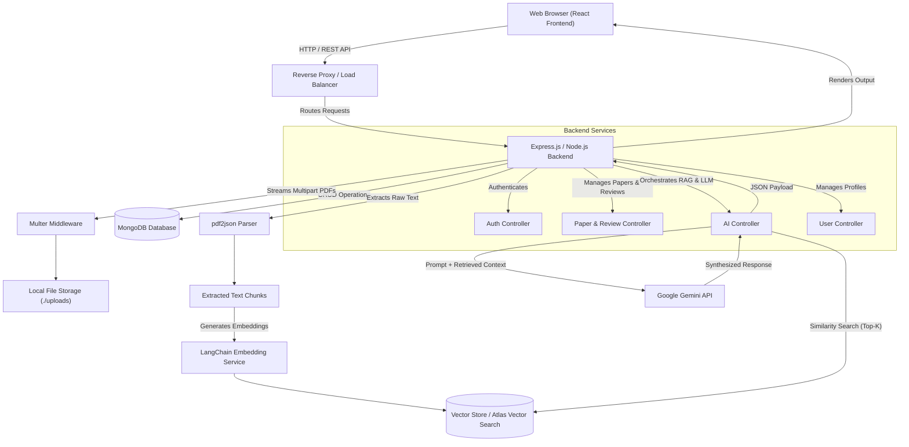

<div align="center">

# PaperPath
### AI-Powered Research Paper Discovery & Filtering via RAG and Google Gemini

[](https://reactjs.org/)
[](https://vitejs.dev/)
[](https://tailwindcss.com/)
[](https://nodejs.org/)
[](https://expressjs.com/)
[](https://www.mongodb.com/)
[](https://ai.google.dev/)
[](https://js.langchain.com/)

**PaperPath** streamlines academic literature review and discovery. Built on the MERN stack, it integrates **Retrieval-Augmented Generation (RAG)** with the **Google Gemini API** to deliver accurate, context-aware answers grounded directly in your uploaded research papers.

[Explore Features](#-key-features) • [System Architecture](#-system-architecture--design) • [RAG Pipeline](#-data-flow--rag-pipeline) • [Getting Started](#-getting-started--installation) • [Authors](#-authors--credits)

</div>

---

## 📖 Table of Contents

1. [Overview](#-overview)
2. [Key Features](#-key-features)
3. [Tech Stack & Dependencies](#-tech-stack--dependencies)
4. [System Architecture & Design](#-system-architecture--design)
5. [Data Flow & RAG Pipeline](#-data-flow--rag-pipeline)
6. [Project Structure](#-project-structure)
7. [Getting Started & Installation](#-getting-started--installation)
8. [Contributing](#-contributing)
9. [Authors & Credits](#-authors--credits)

---

## 🔍 Overview

Navigating dense repositories of scientific literature is time-consuming. **PaperPath** eliminates manual sifting by enabling researchers, students, and engineers to upload PDF manuscripts, index their semantic content, and query complex methodologies or findings using natural language. By pairing **LangChain.js** vector retrieval with **Google Gemini**, PaperPath ensures every generated insight is strictly anchored to the source material, minimizing hallucinations and maximizing research velocity.

---

## ✨ Key Features

* **Context-Aware Paper Q&A**: Query uploaded PDFs in natural language and receive synthesized, citation-backed responses powered by Google Gemini.
* **Retrieval-Augmented Generation (RAG)**: Grounds LLM outputs in actual document chunks using semantic vector embeddings and similarity search.
* **Automated PDF Parsing & Indexing**: Extracts raw text via `pdf2json` and processes metadata datasets via `csv-parser` for rapid ingestion.
* **Library & Review Management**: Upload, organize, and review academic papers alongside user reading progress tracking.
* **Secure Authentication**: Full JWT-based authentication, protected API routes, and automated transactional email workflows via `Nodemailer`.
* **Responsive Modern UI**: Clean, fast interface built with React 18, Vite, Tailwind CSS, and Lucide icons.

---

## 🛠 Tech Stack & Dependencies

### Core Architecture
* **Frontend**: React.js, Vite, Tailwind CSS, Lucide React
* **Backend**: Node.js, Express.js
* **Database**: MongoDB, Mongoose ODM
* **AI & RAG**: Google Gemini API (`@google/genai`), LangChain.js (`@langchain/core`, `@langchain/google-genai`)
* **Authentication & Utilities**: JSON Web Tokens (`jsonwebtoken`), Multer, Nodemailer, `pdf2json`, `csv-parser`

### Backend Packages (`Paper_Path_Backend/package.json`)

| Package | Version | Purpose |
| :--- | :--- | :--- |
| `@google/genai` | `^2.10.0` | Official Google Gemini SDK for direct LLM and embedding interactions |
| `@langchain/core` | `^1.1.48` | Core LangChain abstractions for chains, prompts, and RAG orchestration |
| `@langchain/google-genai` | `^2.1.31` | LangChain integration for Google Gemini models and vector embeddings |
| `express` | `^5.2.1` | Minimalist web framework powering the RESTful API |
| `mongodb` / `mongoose` | `^7.2.0` / `^9.6.2` | NoSQL database driver and schema-based Object Data Modeling (ODM) |
| `jsonwebtoken` | `^9.0.3` | Stateless JWT token generation and verification for route protection |
| `multer` | `^2.2.0` | `multipart/form-data` middleware for handling PDF research paper uploads |
| `pdf2json` | `^4.0.3` | Parses uploaded PDF manuscripts into structured JSON/text for RAG chunking |
| `csv-parser` | `^3.2.1` | High-speed streaming CSV parser for batch paper metadata ingestion |
| `nodemailer` | `^9.0.3` | SMTP client for user verification, notifications, and password resets |
| `cors` / `dotenv` | `^2.8.6` / `^17.4.2` | Cross-Origin Resource Sharing middleware and environment variable loader |
| `nodemon` | `^3.1.14` | *(Dev)* Live-reload server monitor for local backend development |

### Frontend Packages (`Paper_Path_Frontend/package.json`)

| Package | Version | Purpose |
| :--- | :--- | :--- |
| `react` / `react-dom` | `^18.2.0` | Core UI component library and DOM rendering engine |
| `lucide-react` | `^0.263.1` | Customizable SVG icon toolkit for the user interface |
| `vite` | `^4.4.5` | *(Dev)* Next-generation frontend build tool and HMR dev server |
| `tailwindcss` | `^3.3.0` | *(Dev)* Utility-first CSS framework for responsive styling |
| `postcss` / `autoprefixer` | `^8.4.24` / `^10.4.14` | *(Dev)* CSS transformation and automated vendor prefixing |

---

## 🏗 System Architecture & Design

### Architectural Diagram



### Component Breakdown

* **React Frontend**: Manages client-side state, paper browsing, PDF upload forms, and the interactive AI chat interface.
* **Express.js Backend**:
  * **Controllers** (`authController.js`, `aiController.js`, `searchController.js`, `userController.js`): Handle request validation, service invocation, and HTTP responses.
  * **Models** (`paper.js`, `review.js`, `user.js`, `userProgress.js`): Enforce strict Mongoose schemas for users, paper metadata, peer reviews, and reading telemetry.
  * **Services** (`geminiServices.js`): Encapsulate LangChain chunking, embedding generation, vector retrieval, and Gemini API calls.
  * **Middleware & Config** (`authMiddleware.js`, `db.js`, `env.js`, `mailer.js`): Centralize JWT verification, database pooling, environment sanity checks, and SMTP transport.

---

## 🔄 Data Flow & RAG Pipeline

PaperPath implements a 7-stage Retrieval-Augmented Generation lifecycle to ensure high factual precision:

1. **Document Ingestion**: Users upload PDF manuscripts via the React client. `multer` streams the binary to `./uploads`, and `pdf2json` extracts raw textual content.
2. **Text Segmentation & Embedding**: Extracted text is split into overlapping semantic chunks. `geminiServices.js` passes these chunks through `@langchain/google-genai` to generate high-dimensional vector embeddings.
3. **Vector Indexing**: Embeddings are indexed alongside paper metadata in the vector store, linking every mathematical vector back to its source document and paragraph.
4. **Query Vectorization**: When a user submits a research question, `aiController.js` embeds the natural language query into the same vector space using the Gemini embedding model.
5. **Semantic Similarity Search**: LangChain executes a top-$k$ cosine similarity search against the vector store to retrieve the most relevant text passages.
6. **Context-Augmented Prompting**: `aiController.js` constructs a structured system prompt combining the user's question with the retrieved document chunks.
7. **LLM Synthesis**: The augmented prompt is dispatched to the **Google Gemini API**, which synthesizes a grounded answer and returns it to the client UI.

---

## 📂 Project Structure

```text
PaperPath/
├── Paper_Path_Backend/
│   ├── src/
│   │   ├── config/          # Database (db.js), Env (env.js), Mailer (mailer.js)
│   │   ├── controllers/     # Route handlers (auth, ai, search, user)
│   │   ├── middleware/      # JWT protection (authMiddleware.js)
│   │   ├── models/          # Mongoose schemas (paper, review, user, userProgress)
│   │   ├── routes/          # Express API routers (auth, ai, paper, user)
│   │   ├── services/        # RAG & Gemini orchestration (geminiServices.js)
│   │   └── server.js        # Application entry point
│   ├── uploads/             # Local staging directory for uploaded PDFs
│   ├── .env                 # Backend environment variables
│   └── package.json
│
└── Paper_Path_Frontend/
    ├── src/                 # React components, pages, hooks, and assets
    ├── .env                 # Frontend environment variables
    ├── tailwind.config.js   # Tailwind CSS configuration
    ├── vite.config.js       # Vite bundler configuration
    └── package.json
```

---

## 🚀 Getting Started & Installation

### Prerequisites

Ensure you have the following installed on your local machine:
* **Node.js** (v18+ LTS recommended)
* **npm** or **yarn**
* **MongoDB** (Local instance or [MongoDB Atlas](https://www.mongodb.com/atlas) cluster)
* **Google Gemini API Key** (Obtain from [Google AI Studio](https://aistudio.google.com/))

### 1. Clone the Repository

```bash
git clone [https://github.com/Karan9389/PaperPath.git](https://github.com/Karan9389/PaperPath.git)
cd PaperPath
```

### 2. Backend Configuration

Navigate to the backend directory and install dependencies:

```bash
cd Paper_Path_Backend
npm install
```

Create a `.env` file in the `Paper_Path_Backend/` root and populate it with your credentials:

```env
PORT=5000
MONGO_URI=mongodb+srv://<username>:<password>@cluster.mongodb.net/paperpath
JWT_SECRET=your_super_secret_jwt_signing_key
GEMINI_API_KEY=your_google_gemini_api_key
EMAIL_USER=your_smtp_email@example.com
EMAIL_PASS=your_smtp_app_password
```

### 3. Frontend Configuration

Open a new terminal window, navigate to the frontend directory, and install dependencies:

```bash
cd ../Paper_Path_Frontend
npm install
```

Create a `.env` file in the `Paper_Path_Frontend/` root:

```env
VITE_API_URL=http://localhost:5000/api
```

### 4. Run the Application

Start both servers in separate terminal sessions:

**Terminal 1 — Run Backend Server:**
```bash
cd Paper_Path_Backend
npm run dev
```
*The backend API will initialize at `http://localhost:5000`.*

**Terminal 2 — Run Frontend Client:**
```bash
cd Paper_Path_Frontend
npm run dev
```
*The Vite development server will launch at `http://localhost:5173`. Open this URL in your browser.*

---

## 🤝 Contributing

Contributions make the open-source community a fantastic place to learn, inspire, and build.

1. **Fork** the repository.
2. **Create** your feature branch (`git checkout -b feature/AmazingFeature`).
3. **Commit** your changes (`git commit -m 'Add some AmazingFeature'`).
4. **Push** to the branch (`git push origin feature/AmazingFeature`).
5. **Open** a Pull Request.

---

## 👥 Authors & Credits

Designed, architected, and developed by:

* **Karan Kumar** — [@Karan9389](https://github.com/Karan9389)
* **Aditya Kushwaha**

---

<div align="center">
  <sub>Built with ❤️ using the MERN Stack, LangChain.js, and Google Gemini.</sub>
</div>
